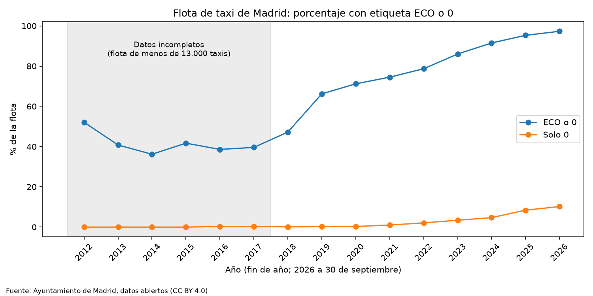

# La flota de taxi de Madrid: ¿cuánto ha cambiado en sostenibilidad?

Análisis con datos abiertos reales del Ayuntamiento de Madrid. Proyecto de portfolio de análisis de datos (Python y Pandas).

## El problema
Una asociación imaginaria quiere entender cómo es hoy la flota de taxi de Madrid y cómo ha cambiado en sostenibilidad. Formulé yo mismo las preguntas:

1. ¿Cuántos taxis hay y cómo se reparten por tipo de combustible?
2. ¿Qué porcentaje de la flota es ECO o cero emisiones?
3. ¿Cómo ha cambiado esa proporción con el tiempo?
4. ¿Qué marcas y modelos dominan?
5. ¿Qué antigüedad tienen los vehículos?
6. ¿Qué modelos lideran en cada tipo de combustible?

## Fuente de los datos
- **Conjunto de datos:** Taxi. Datos históricos de flota de vehículos
- **Origen:** Portal de datos abiertos del Ayuntamiento de Madrid
- **Enlace:** https://datos.madrid.es/dataset/300219-0-taxi-flota
- **Licencia:** Creative Commons Attribution 4.0 International (CC BY 4.0)
- **Cobertura:** del 1 de enero de 2012 al 30 de septiembre de 2026
- **Fecha de descarga:** 29 de octubre de 2026

## Qué hice
1. **Exploración** antes de tocar nada: 32.376 filas y 19 columnas (incluye vehículos dados de baja).
2. **Flota activa:** me quedé con los vehículos sin fecha de baja, 15.665 taxis (coincide con los ~15.000 que indica el portal).
3. **Comprobaciones:** sin duplicados; el combustible no tenía erratas, solo categorías mezcladas.
4. **Fechas:** convertí a fecha real con formato día/mes/año explícito.
5. **Fechas anómalas:** 50 filas (33 con inicio anterior a 2012 y 17 con baja anterior al inicio). Las 17 con baja anterior al inicio las excluí solo de la serie temporal. Las 33 antiguas no tienen baja y se mantienen como activas (0,2% de la flota).
6. **Modelos:** quité la marca repetida dentro del modelo (Skoda Rapid, Ford Tourneo Connect).
7. **Serie temporal:** reconstruí la flota de cada fin de año con las fechas de inicio y de baja.

## Hallazgos
- La flota activa es de **15.665 taxis** y el **70,3%** son híbridos de gasolina. Siguen los eléctricos (9,2%), gasolina/GLP (7,2%) y GNC (6,8%).
- El **97,3%** tiene etiqueta ECO o 0, y el **10,2%** tiene etiqueta 0 (1.439 eléctricos, 151 híbridos enchufables y 5 híbridos normales).
- Entre 2018 y 2026, los taxis ECO o 0 pasaron del **47,2% al 97,3%** y los de etiqueta 0 del **0,1% al 10,2%**.
- **Toyota** concentra el 68,9% de la flota. Los modelos más comunes son el Corolla Sedan (5.355) y el Prius Plus (2.999).
- La flota es joven: **mediana de 3,7 años** (media de 4,2).
- Líderes por combustible: híbrido gasolina, Corolla Sedan; eléctrico, Toyota BZ4X; GNC, Seat León ST; gasolina/GLP, Dacia Lodgy.



## Cómo ejecutarlo
```
git clone <URL_DEL_REPOSITORIO>
cd taxi-madrid-flota
python3 -m venv venv
source venv/bin/activate
pip install -r requirements.txt
jupyter notebook
```
Abre `analisis_taxi.ipynb`. El CSV está en la carpeta `datos`; si prefieres bajarlo tú, usa el enlace de la fuente.

## Limitaciones
- **Antes de 2018 el fichero está incompleto** (1.807 taxis en 2012 frente a unos 15.000 reales). No conozco la causa, y no interpreto esos años.
- Hay 33 vehículos con inicio anterior a 2012 que figuran como activos. No sé por qué.
- 5 híbridos normales tienen etiqueta 0 y no sé por qué.
- No uní los modelos Corolla (Sedan, TS y sin sufijo) ni Custom y Tourneo Custom, porque los datos no indican si son el mismo vehículo.
- La tabla de modelos por combustible deja fuera 8 combustibles con menos de 100 taxis (250 taxis, el 1,6%).
- 2 vehículos sin fecha de matriculación quedaron fuera del cálculo de edad.
- Los datos describen la flota, no los viajes ni los ingresos.

## Para profundizar
Datos de viajes o ingresos, el histórico completo anterior a 2018 (consultar al Ayuntamiento) y cruzar la flota con datos de tráfico o BiciMAD.
